# Bank Portfolio : AI Banking Assistant with MCP

A banking web application enhanced with an **AI-powered conversational assistant**, built using **Java 21, Spring Boot, Spring AI, Model Context Protocol (MCP), Groq, JDBC, and SQLite**.

The project demonstrates how a Large LLM can interact with banking services through MCP tools to retrieve account information, consult transaction histories, and generate financial insights.

## Features

### Banking Application
- Client management
- Bank account management
- Deposits and withdrawals
- Transfers between accounts
- Authorized overdraft management
- Transaction history
- SQLite persistence with JDBC
- Transaction management using `commit()` and `rollback()`

### AI Banking Assistant
- Natural language interaction with banking data
- Account balance consultation
- Customer information retrieval
- Transaction history analysis
- AI-generated financial summaries and budgeting suggestions
- MCP-based tool calling
- Conversational web interface with Markdown and table rendering

## Technology Stack

| Technology | Purpose |
|---|---|
| Java 21 | Backend development |
| Spring Boot | Application framework |
| Spring MVC | REST API and web controllers |
| Spring AI | LLM integration and MCP support |
| MCP | Protocol for exposing and invoking AI tools |
| Groq | LLM inference API |
| GPT-OSS 120B | Language model |
| Thymeleaf | Server-side rendering |
| Tailwind CSS | User interface styling |
| JDBC | Database operations |
| SQLite | Database |
| Maven | Build and dependency management |

## Architecture

The project consists of **two independent Spring Boot applications**.

```text
USER -> Web Interface Thymeleaf -> BANK PORTFOLIO WEB :8080 -> Spring AI ChatClient -> Groq LLM -> Tool Call Decision -> MCP Client -> MCP / Streamable HTTP -> BANK MCP SERVER :8081 -> MCP Tools -> REST API -> BANK PORTFOLIO WEB :8080 -> BanqueService -> Repositories -> JDBC / SQLite
```

The LLM determines when a tool is needed. Spring AI executes the tool call through the MCP client, and the MCP server communicates with the banking application's REST API.

The result is returned to the LLM, which generates the final response.

### MCP Tools

| Tool | Description |
|---|---|
| `getClients` | Retrieves the list of banking clients |
| `getAccountBalance` | Retrieves an account balance |
| `getAccountTransactions` | Retrieves an account's transaction history |

The MCP server exposes these operations using Spring AI's `@McpTool` annotation.

## Project Structure

```text
bank-portfolio-ai-mcp/
├── bank-portfolio-web/
│   ├── src/
│   ├── database/
│   │   └── schema.sql
│   ├── pom.xml
│   └── mvnw
│
├── bank-mcp-server/
│   ├── src/
│   ├── pom.xml
│   └── mvnw
│
├── docs/
├── .gitignore
├── LICENSE
└── README.md
```

### Application Responsibilities

**bank-portfolio-web (Port 8080)**

- Banking business logic
- Database persistence
- Thymeleaf web interface
- REST API for banking data
- Spring AI ChatClient
- MCP Client
- Groq integration

**bank-mcp-server (Port 8081)**

- Independent MCP server
- MCP tool registration and execution
- HTTP communication with the banking REST API

## Screenshots

### 1. Home Page

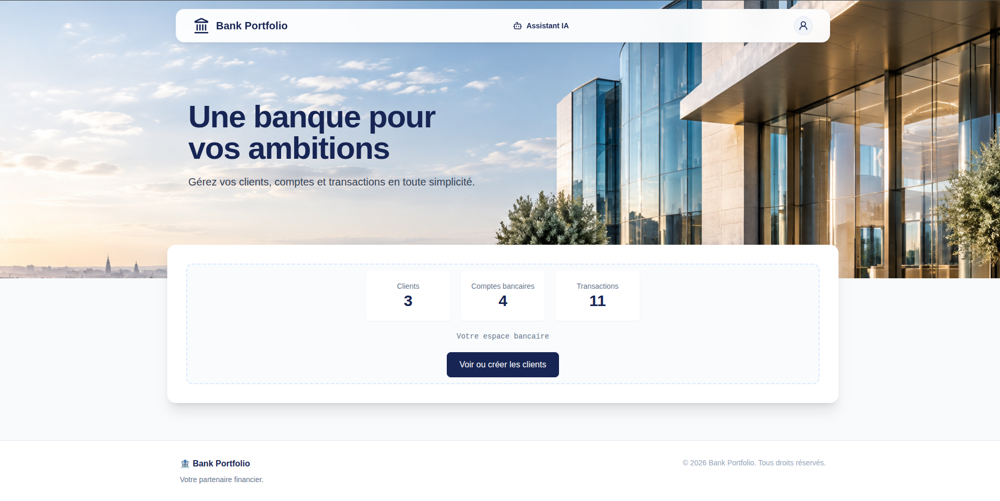

### 2. Client Management

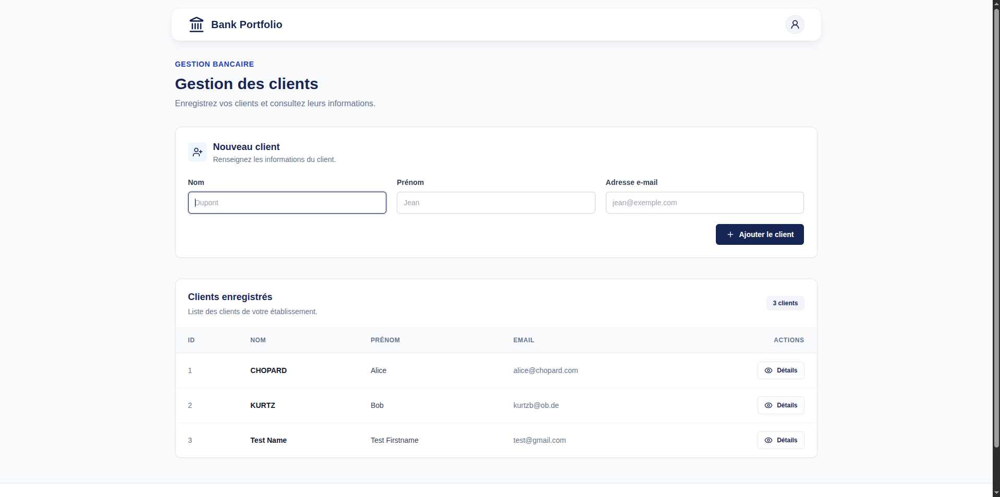

### 3. Bank Accounts

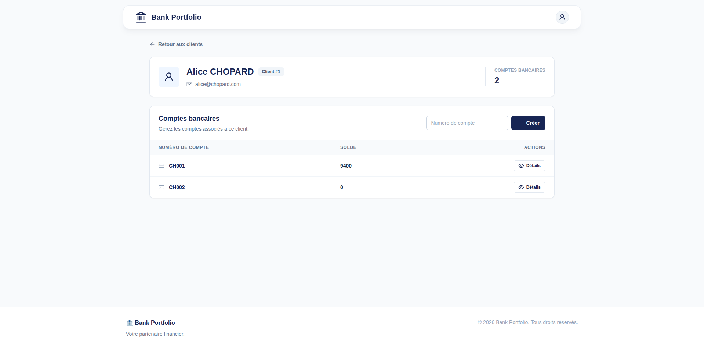

### 4. Account Details

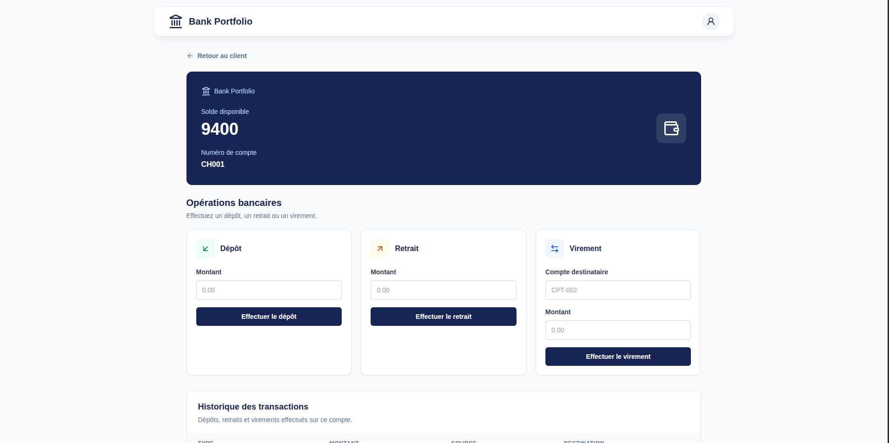

### 5. Transaction History

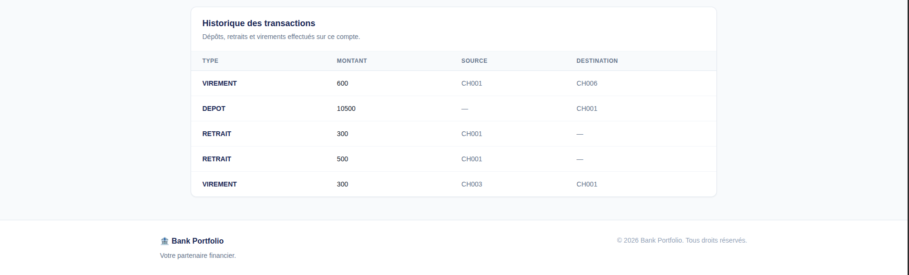

### 6. AI Banking Assistant

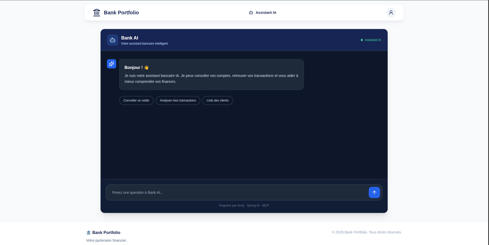

### 7. Additional Demonstrations

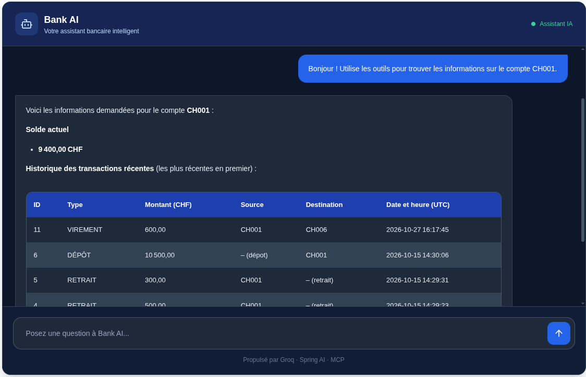

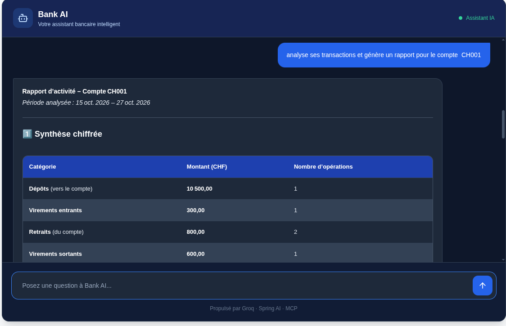

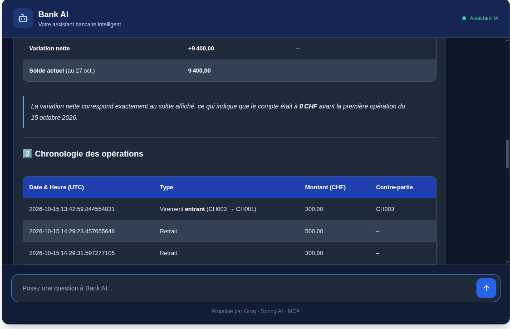

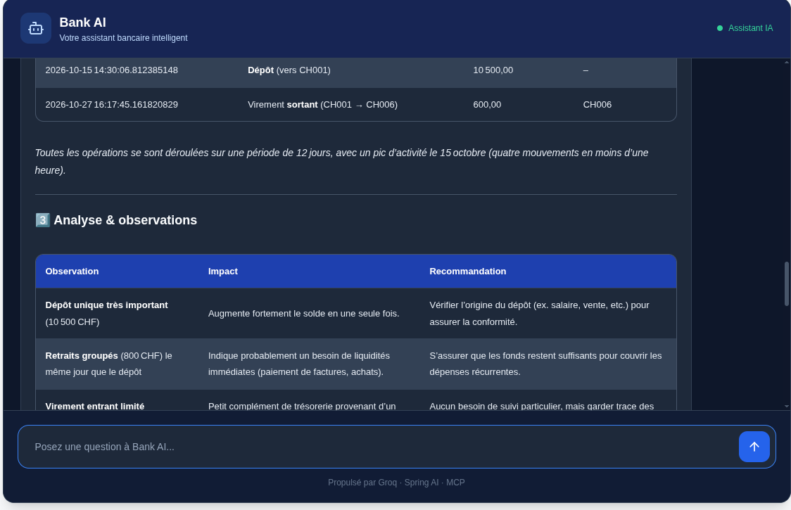

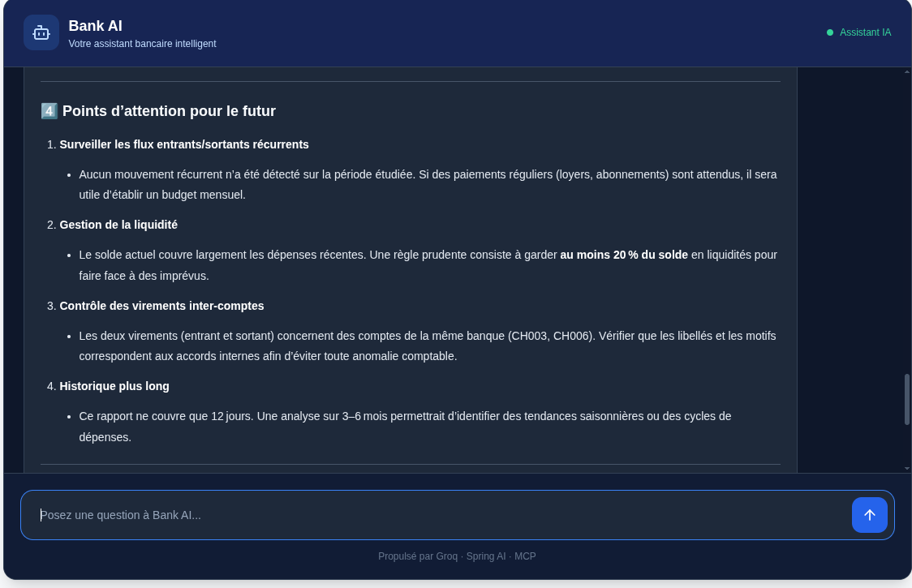

## Getting Started

### Prerequisites

- Java 21
- Maven
- A Groq API key

### 1. Clone the Repository

```bash
git clone https://github.com/romualdfolly/bank-portfolio-ai-mcp.git
cd bank-portfolio-ai-mcp
```

### 2. Start the MCP Server

Open your first terminal:

```bash
cd bank-mcp-server
./mvnw spring-boot:run
```

The MCP server starts on **http://localhost:8081**.

Keep this terminal running.

### 3. Configure the Groq API Key

Open a second terminal from the repository root:

```bash
cd bank-portfolio-web
```

Create a `.env` file:

```env
GROQ_API_KEY=your_groq_api_key_here
```

Load the environment variables:

```bash
set -a && source .env && set +a
```

This step exports the Groq API key to the current session.

### 4. Start the Banking Application and MCP Client

In the same terminal where the environment variables were loaded:

```bash
./mvnw spring-boot:run
```

The banking application starts on **http://localhost:8080**.

The SQLite database is automatically initialized by the application.

### 5. Access the Application

Open the banking web application:

**http://localhost:8080**

Open the AI assistant:

**http://localhost:8080/chat**

You can now ask questions such as:

- "What is the balance of account CH001?"
- "Show me all banking clients."
- "Display the transaction history of account CH001."
- "Analyze account CH001 transactions and suggest budgeting improvements."

The assistant uses MCP tools to retrieve banking data before generating its response.

## How MCP Tool Calling Works

1. The user submits a question through the web interface.
2. The Spring AI `ChatClient` sends the request to the Groq-hosted LLM.
3. The LLM identifies whether an MCP tool is needed.
4. Spring AI invokes the tool through the MCP Client.
5. The MCP Server executes the corresponding Java method.
6. The MCP tool calls the banking application's REST API.
7. The REST API retrieves data through the service and repository layers.
8. The tool result is returned to the LLM.
9. The LLM generates a natural language response for the user.

MCP enables the separation of AI orchestration from the implementation of business tools.

## Project Evolution

This project builds upon two earlier stages of development:

1. **[Java SE Banking Application](https://github.com/romualdfolly/bank-portfolio-manager-java-cli)** : Banking operations implemented with Java, JDBC, and SQLite.
2. **[Spring Boot Banking Application](https://github.com/romualdfolly/bank-portfolio-spring-boot)** : Web application using Spring MVC, Thymeleaf, and a layered architecture.
3. **AI + MCP Integration (this repository)** : AI-powered assistant using Spring AI, Groq, and an independent MCP server.

This evolution demonstrates the integration of traditional Java backend development with modern AI agent tooling.
